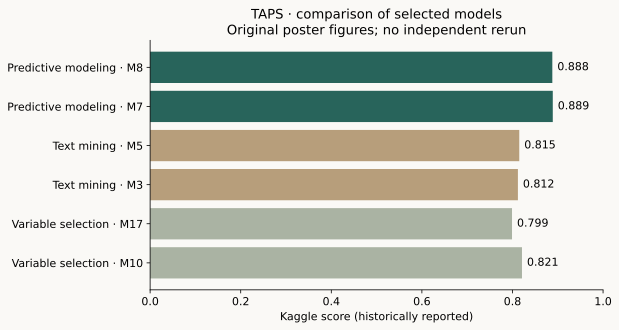

# FastTrack to Recovery — Survivor Survey Classification

Purdue University, September–November 2024. Partner: Tragedy Assistance Program for Survivors (TAPS). Team: Christian Leidholm, Raina Kunder, Alec Walter and Chau Nguyen; faculty mentor Matthew A. Lanham.

## Research problem
How can survey responses support classification into six grief-journey stages, and can fewer inputs preserve classification quality? The team compared structured predictive modeling, text mining and backward variable elimination. This was a research prototype supporting human review, not a clinical assessment.

## Recovered methodology
The author confirmed that the supplied script is team source with inherited instructional wording, and that models were compared by changing caret's method parameter. The cleaned script retains the saved glmnet baseline, q4–q20 formula, LOOCV design, Accuracy selection, numeric survey predictors and original range transformations. An explicit `rf` option preserves the author-confirmed Random Forest variant. The poster's best model is RF with range + YeoJohnson preprocessing; its complete tuning/checkpoint is not available. The optional rf run here is not asserted to recreate that exact configuration.

Text exploration is a separate branch: language detection, optional authorized translation, tokenization, stop-word removal and counts. It does not become an invented integrated NLP classifier.

## Historical results
The poster reports a best structured-model **Kaggle score of 0.889**, with a second score of 0.888. Selected text-mining scores are 0.812 and 0.815; variable-selection scores are 0.821 and 0.799. The figure labels these as Kaggle scores; the scoring definition has not been independently verified. No score has been reproduced because the original dataset is unavailable.



The poster's 100,000+ figure describes survivors served by TAPS, not a verified model dataset size. Assumption-based efficiency illustrations contain conflicting percentages; no numerical efficiency or achieved operational impact is claimed here. These discrepancies remain open in the SOP/CV verification record.

## Run with authorized data
```sh
Rscript setup.R
Rscript src/grief_stage_classification.R /private/examples.csv /private/test.xlsx glmnet outputs
Rscript src/grief_stage_classification.R /private/examples.csv /private/test.xlsx rf outputs-rf
Rscript src/survey_text_exploration.R /private/examples.csv
```
See data/README.md. Fixes are limited to the seed typo, data paths, row-index construction in text exploration, and explicit output labels. External translation requires an explicit opt-in flag; no survey text was sent during restoration.

## Limitations
Historical global preprocessing precedes LOOCV and independently scales test data; zero-variance removal uses positional columns. These weaknesses are preserved and disclosed, not hidden by a new pipeline. The source confusion matrix is resubstitution, not held-out evaluation. Exact final feature set, tuning, data counts and competition scoring require the missing artifacts. Only syntax and missing-input handling can be validated without data. Original sources remain private; no license or data redistribution rights are assumed.

[Portfolio case study](https://chau-nguyen-research.gabledmango1.chatgpt.site/taps.html)
